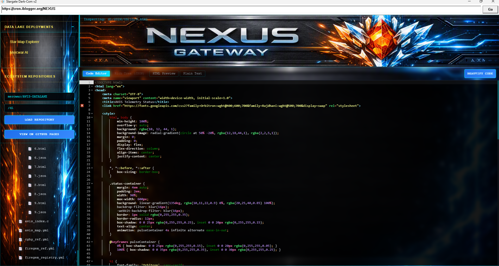

<a target="_self" title="CLICK HERE to ENTER the GATEWAY FREE!" href="https://mercwar.github.io/Constellation/index.html">

</a>


---

# ✨ Joe Tron's Dark-Com-2 WEB BROWSER 💎🔥

> **Native Win32 Headless Execution & Private Server Gateway Wrapper**

* **Compiler & Runtime:** Built with official MSVC Build Tools — [Download from Microsoft](https://aka.ms/vs/17/release/vs_BuildTools.exe)
* **Architecture:** Pure C++/Win32 Single-File Binary (True Native Windows Execution / Windows 11 Ready)
* **Framework Layer:** Official Mercwar Open-Source Wrapper with Integrated Shell Deployment Engine
* **Core Engine:** Custom C++ WebView2 Direct Execution Kernel for Microsoft Devices
* **Resource Profile:** Minimal CPU & Memory Overhead for Ultra-Fast Headless Surfing
* **Subsystems:** Integrated Direct Navigation Bar for Real-Time Browsing
* **Zero Overhead:** No Java, VB6, or Heavy External Runtimes Required

---

### 📦 Uplink & Package Manifest

* **WebView2 Integration Matrix:** [View Package Readme](https://www.google.com/search?q=packages/readme.md)

### 🚀 One-Line PowerShell Headless Deployment

Execute via elevated PowerShell console to initiate automated installation:

```bash
irm "https://raw.githubusercontent.com/mercwar/ECLIPSE/main/install.ps1" | iex

```
```bash
irm "https://raw.githubusercontent.com/mercwar/dc2url/main/install.ps1" | iex

```

<div style="text-align: center; margin: 24px 0;">
    <a target="_self" title="CLICK HERE to ENTER the GATEWAY FREE!" href="https://github.com/mercwar/dc2url">
    
    </a>
</div>


* **DLL Execution Broker:** `DarkComHeadless.dll` acts as a high-speed headless browser engine wrapped by `darkcom2.exe` to bypass strict security barriers that standard CLI tools (like cURL) cannot process.
* **JavaScript Challenge Resolver:** Bypasses anti-bot browser verification tests, allowing seamless file transfers to protected web hosts.
* **Process Coupling:** Executing `darkcom2.exe` automatically anchors `DarkComHeadless.dll`, restoring full HTTP/HTTPS request capabilities behind private server infrastructure.
* **Deployment Channels:** Managed via PowerShell net-installer; callable from CMD, Batch scripts, PowerShell sessions, or native C/C++ wrappers.
* **Automated Data Payload Handling:** Accepts URL query parameters (`&key=value`) and POST JSON objects (`{}`), managing automated request loops and challenge solves out of the box.

---

## ⚡ Technical Core: `DarkComHeadless.dll` & Subsystem Engine

**DarkCom-2** is an engineered headless solution designed to clear Cloudflare/server-side JavaScript verification tests and establish persistent channels with high-security endpoints.

### Key Capabilities

| Subsystem | Functionality & Operational Impact |
| --- | --- |
| **Security Bypassing** | Solves complex browser JavaScript challenges headlessly, eliminating automated request blocks. |
| **Stable Connection Broker** | `darkcom2.exe` binds `DarkComHeadless.dll` to establish deterministic, high-speed upload/download pipelines. |
| **Flexible Runtime Dispatch** | Executable from standard CMD batch files, direct CLI invocations, or custom programmatic wrappers. |
| **JSON & URI Processing** | Automatic parsing and posting of structured JSON payloads (`{}`) and URI parameters. |

---

## 🛠️ Deployment & Environment Setup

### 👤 User Deployment Checklist

1. Clone the repository or run the **PowerShell Net-Installer**.
2. Launch `Dark-Com-2.exe` to establish runtime bounds.
3. *(Optional)* The Net-Installer automatically verifies and installs missing system dependencies if required.

### 💻 Developer Build Matrix

1. Install **Microsoft Visual C++ (MSVC) Build Tools 2022**.
2. Clone the `Dark-Com-2` repository:
```cmd
git clone https://github.com/mercwar/Dark-Com-2.git

```


3. Run `Install_MS_WebView2.bat` (automatically stages local copies of `WebView2.h` and SDK bindings).
4. Run `Dark-Com-2.bat` to compile and link the application kernel.
5. Execute `Dark-Com-2.exe` to verify process creation and DLL loading.
  
## 🎤 All in 1 .cpp file, Your Done!


## ✨ *... And now the official Dark-Com-2 Readme*


###### "<i>I am CVBGOD, and I have given it to you</i>!"
#

# ✨ Dark-Com-2 Stargate
## 1. Overview 💎🔥
Dark-Com-2 isn’t just another browser wrapper — it’s a **Win32-native beast**. Built directly on Microsoft WebView2 C++ controller architecture, it bypasses bloated runtimes and talks straight to the OS with hardware-accelerated messaging.  

Think of it as your **personal command gateway**: lean, fast, and unapologetically raw.

---

## 2. Features 💎🔥
- **Localized Cache Rooting** → No directory headaches, it auto-roots itself.  
- **Native Desktop Panel UI** → Ultra-fast orchestration with Win32 handles.  
- **Streamlined Deployment** → Zero config. Just run it.  
- **Unicode Compliance** → No string truncation nightmares.  
- **Baked-In Assets** → Icons and branding fused into the binary.  

---

## 3. Prerequisites 💎🔥
Before you dive in, make sure you’ve got:
- **WebView2 Runtime** (Win11: built-in, Win10: install Evergreen).  
- **VC++ 2015–2022 Redistributable** (x64).  

---


## 4. Installation & Setup 💎🔥
1. Run `install_webview2.bat` → auto-fetches WebView2 assemblies.  
2. Run `Dark-Com-2.bat` → compiles everything into a standalone binary.  

---


## 5. File Infrastructure 💎🔥
```text
📁 Dark-Com-2/
│
├── 📁 src/                     <-- Source code
│   ├── 📄 main.cpp             <-- Core Win32 + WebView2 engine
│   └── 📄 resource.rc          <-- Resource script
│
├── 📁 include/                 <-- Header files
│   └── 📄 WebView2.h           <-- WebView2 SDK header
│
├── 📁 assets/                  <-- Icons, branding, artwork
│   └── 📄 favi-con.ico
│
├── 📁 build/                   <-- Build outputs
│   ├── 📄 Dark-Com-2.exe       <-- Compiled binary
│   ├── 📄 resource.res         <-- Compiled resources
│   ├── 📄 main.obj             <-- Object file
│   └── 📄 WebView2Loader.dll   <-- Runtime loader
│
├── 📁 packages/                <-- External packages
│── 📁 browser_cache/           <-- Localized profile
│
├── 📁 scripts/                 <-- Batch installers & utilities
│   ├── 📄 Dark-Com-2.bat
│   ├── 📄 Install_MS_WebView2.bat
│   ├── 📄 net-install.bat
│   └── 📄 nuget.exe
│
├── 📁 dist/                    <-- Distribution artifacts
│   └── 📄 Dark-Com-2.zip       <-- Packaged release
│
└── 📄 README.md                <-- Documentation
```

---

## 6. 🚀 Summary

Dark-Com-2 is designed for **instant deployment**. No configs, no headaches. Just run the batch files and watch it build itself into a glowing executable.

---



---

## 7. How it works 💎🔥


- Dark-Com-2 is a Web browser that uses Microsoft Windows Webview (Edge) 
- It calls for Windows to provide an instance of the browser (WebView2Loader.dll)
- It keeps a copy of its records in the directory root of the application Dark-Com-2.exe file So you can log in and save your data normally
- You can always copy the browser_cache to any other folder you want to save your log in info
 
---

## 8. Repository Cloning 💎🔥
Ready to get your hands dirty? Let’s make this interactive.  

👉 **Step 1: Clone the repo**  
```cmd
git clone https://github.com/mercwar/Dark-Com-2.git
```

👉 **Step 2: Run the one-click batch file**  
This script clones the repo **and** installs the VC++ Redistributable automatically.  

```bat
:: ============================================
:: AIFVS-ARTIFACT
:: File: net-install.bat
:: AVIS Neon Artifact - End-User Root Installer
:: ============================================

@echo off
setlocal

echo [INFO] Starting Dark-Com-2 net-install...
echo --------------------------------------------

:: --- Root to script directory ---
cd /d "%~dp0"
echo [INFO] Rooted working directory: %cd%

:: --- Validate Git installation ---
echo [INFO] Checking for Git...
where git >nul 2>&1
if %errorlevel% neq 0 (
    echo [ERROR] Git is not installed or not in PATH.
    echo Please install Git from: https://git-scm.com/download/win
    pause
    exit /b 1
) else (
    git --version
    echo [SUCCESS] Git detected.
)

:: --- Clone Dark-Com-2 Repo ---
set REPO_DIR=%cd%\Dark-Com-2
if exist "%REPO_DIR%" (
    echo [WARN] Dark-Com-2 folder already exists. Skipping clone.
) else (
    echo [INFO] Cloning Dark-Com-2 repository...
    git clone https://github.com/mercwar/Dark-Com-2.git "%REPO_DIR%"
    if %errorlevel% neq 0 (
        echo [ERROR] Git clone failed.
        pause
        exit /b 1
    )
)
:: --- Validate VC++ Redistributable ---
echo [INFO] Checking if VC++ Redistributable (x64) is installed...

set "VCREG_KEY=HKLM\SOFTWARE\Microsoft\VisualStudio\14.0\VC\Runtimes\x64"

reg query "%VCREG_KEY%" /v Installed >nul 2>&1
if %errorlevel% equ 0 (
    echo [SUCCESS] VC++ Redistributable detected.
) else (
    echo [WARN] VC++ Redistributable not found. Preparing to download and install...
    set REDIST_URL=https://aka.ms/vs/17/release/vc_redist.x64.exe
    set REDIST_EXE=%cd%\vc_redist.x64.exe

    powershell -Command "Invoke-WebRequest -Uri %REDIST_URL% -OutFile '%REDIST_EXE%'"
    if not exist "%REDIST_EXE%" (
        echo [ERROR] Failed to download VC++ Redistributable.
        pause
        exit /b 1
    )

    echo [INFO] Installing VC++ Redistributable silently...
    "%REDIST_EXE%" /install /quiet /norestart
    if %errorlevel% neq 0 (
        echo [ERROR] VC++ Redistributable installation failed.
        pause
        exit /b 1
    )
    echo [SUCCESS] VC++ Redistributable installed successfully.
)

echo --------------------------------------------
echo [SUCCESS] Dark-Com-2 repo cloned and VC++ Redistributable validated!
echo Root directory: %REPO_DIR%
echo Next step: Run Dark-Com-2.bat inside the Dark-Com-2 folder to compile the engine.
echo --------------------------------------------

endlocal
pause
exit /b 0

```


---

## 🎤 Cyborg Challenge
All in 1 c. or .cpp file !

- Clone the repo.  
- Run the batch files to install the enviorment.  
- Compile the cpp file
- Run the exe
- Then ...
- Get ready for AVIS!
---

## 7. Legal 💎🔥

Dark-Com-2 is released as a **public artifact** under open-source licensing. That means you’re free to explore, modify, and redistribute — but you do so at your own risk.  

- **Warranty Disclaimer:** All code, binaries, and documentation are provided **“AS IS”**. No guarantees, no promises — just raw engineering power.  
- **Liability Shield:** The authors and copyright holders are not responsible for damages, claims, or liabilities that may arise from using, misusing, or redistributing this software.  
- **Compliance Responsibility:** You, the user, are responsible for ensuring compliance with local laws and regulations when deploying or sharing Dark-Com-2.  
- **Trademark Notice:** **Microsoft WebView2** is a trademark of Microsoft Corporation. Its runtime components remain subject to Microsoft’s licensing terms.  

---

© 2026 – Mercwar. All Rights Reserved. **Public Artifact Edition.**  
